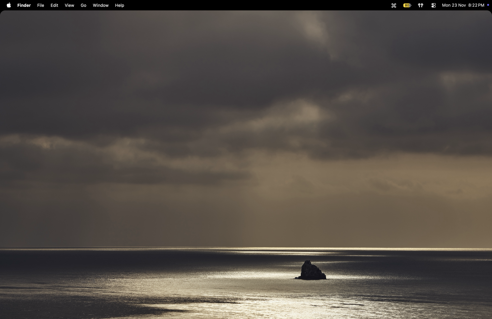

# hide-notch

A small command line tool that makes the menu bar black on Macs with a notch, so the notch blends in.



## How it works

macOS picks the menu bar text color from the wallpaper behind it. hide-notch paints a black strip across the top of your wallpaper, as tall as the menu bar, and sets the result as your wallpaper. It also adds curved corners under both ends of the strip so rounded window corners meet the bar cleanly.

Your original wallpaper path and scaling are saved, so `off` restores them exactly.

A background watcher re-applies the strip when displays change, Spaces change, or the Mac wakes. It does not poll. Idle CPU is 0% and memory use is about 7 MB.

## Requirements

- A Mac with a notch
- macOS 27 on Apple silicon
- A single static image as the wallpaper
- Xcode command line tools, for `swiftc`

## Install

```
git clone https://github.com/aungsh/hide-notch.git
cd hide-notch
./build.sh
```

This builds the tool and copies it to `~/.local/bin/hide-notch`. Make sure that folder is in your `PATH`:

```
export PATH="$HOME/.local/bin:$PATH"
```

## Run

```
hide-notch on
```

This hides the notch and starts the watcher as a LaunchAgent, so it keeps working after a restart. To undo everything:

```
hide-notch off
```

## Commands

| Command    | What it does                                                        |
| ---------- | ------------------------------------------------------------------- |
| `on`       | Hide the notch now and keep it hidden. Starts at login.             |
| `off`      | Stop the watcher and restore the original wallpaper.                |
| `status`   | Show notch size, state, and wallpaper per display.                  |
| `radius N` | Set the corner radius in points. Default 16, 0 removes the corners. |
| `apply`    | Apply once without the watcher.                                     |
| `restore`  | Restore once without stopping the watcher.                          |
| `watch`    | Run the watcher in the foreground.                                  |

If the corners do not line up with your windows, try `hide-notch radius 20` and adjust until they match.

## Limits

- Only notched screens are changed. External displays are left alone.
- Shuffle folders are not supported. Dynamic wallpapers are flattened to their first frame.
- The generated wallpaper is a JPEG at quality 0.95, so there is a small quality loss.
- If you choose a new wallpaper while the tool is on, the watcher applies the strip to it within about a second.

## Files

Generated wallpapers and settings live in `~/Library/Application Support/hide-notch/`. The LaunchAgent is `~/Library/LaunchAgents/local.hide-notch.plist`. `hide-notch off` deletes the generated wallpapers and the LaunchAgent. It keeps the small `state.json` and `radius` files.
